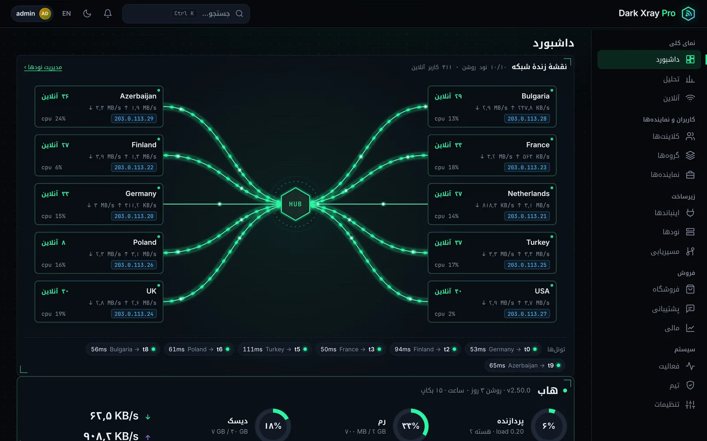
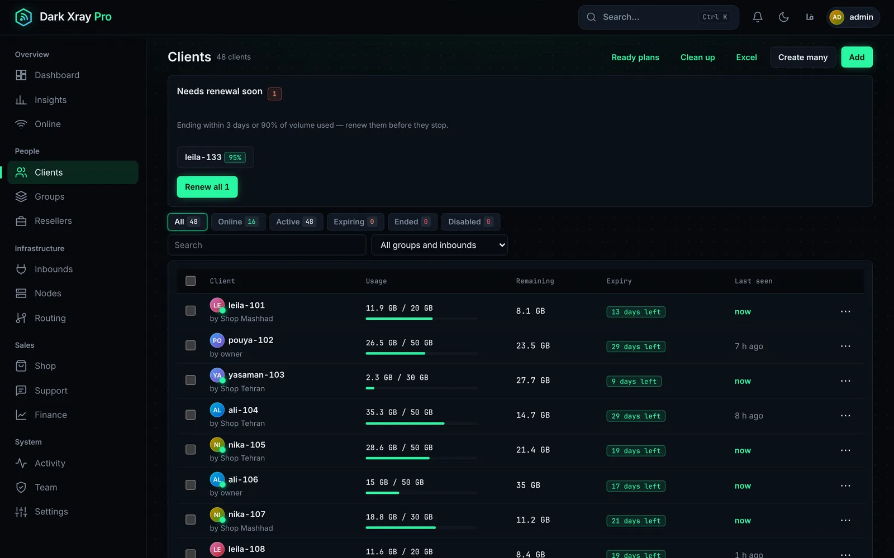
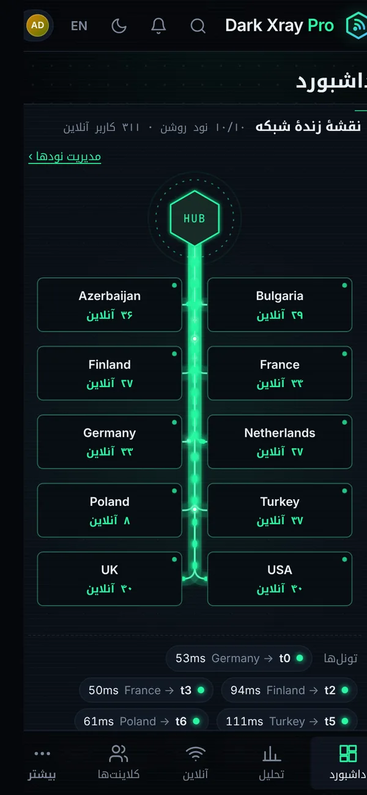
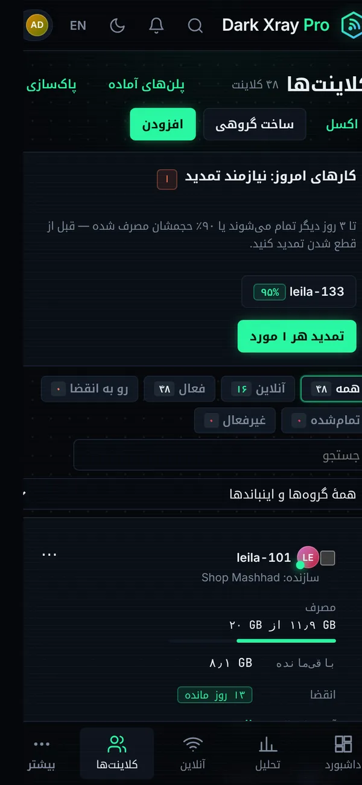

<div align="center" dir="rtl">

# Dark Xray Pro

**پنل چندسروره‌ی Xray با نماینده‌ها، فروشگاه تلگرامی و API سازگار با پاسارگاد**

یک هاب، هر تعداد نود را مدیریت می‌کند. مشتری‌ها، نماینده‌ها و پرداخت‌ها یک‌جا هستند؛
نودها فقط Xray را اجرا می‌کنند و حتی وقتی پنل در دسترس نیست هم به کار ادامه می‌دهند.

[English](README.md) · [نصب](#نصب) · [امکانات](#امکانات) · [مدیریت با dxp](#مدیریت-با-dxp) · [نسخه‌ها](https://github.com/darktunnelmika/dark-xray-pro/releases)



</div>

<div dir="rtl">

## نصب

روی یک سرور تازه‌ی Ubuntu 22.04 به بالا یا Debian 12 به بالا (amd64 یا arm64)، با کاربر root:

</div>

```bash
bash <(curl -fsSL https://raw.githubusercontent.com/darktunnelmika/dark-xray-pro/main/scripts/install.sh)
```

<div dir="rtl">

نصب‌کننده دامنه (اختیاری)، پورت پنل، گواهی (Let's Encrypt رایگان، فایل‌های خودتان یا بدون گواهی)، نام کاربری
و رمز مدیر و آدرس مخفی پنل را می‌پرسد و در پایان آدرس پنل را نشان می‌دهد. حدود دو دقیقه طول می‌کشد.
بعد از نصب، با دستور `dxp` منوی مدیریت باز می‌شود.

برای افزودن نود، در پنل به **نودها ← افزودن نود** بروید و دستور یک‌خطی‌ای را که نشان می‌دهد روی سرور نود اجرا کنید.
نود به چیز دیگری نیاز ندارد.

<details>
<summary>نصب بدون پرسش</summary>

هر پرسش یک متغیر دارد؛ با `DXP_YES=1` برای هر چیزی که مقدار ندهید پیش‌فرض گذاشته می‌شود.

</div>

```bash
DXP_YES=1 DXP_DOMAIN=panel.example.com DXP_CERT=1 DXP_ADMIN=admin DXP_PASS='a-long-password' \
  bash <(curl -fsSL https://raw.githubusercontent.com/darktunnelmika/dark-xray-pro/main/scripts/install.sh)
```

<div dir="rtl">

| متغیر | معنی | پیش‌فرض |
| --- | --- | --- |
| `DXP_DOMAIN` | دامنه‌ی پنل (باید به سرور اشاره کند) | IP سرور |
| `DXP_PORT` | پورت پنل | `2087` |
| `DXP_CERT` | `1` Let's Encrypt، `2` فایل خودتان، `3` بدون گواهی | با دامنه `1` |
| `DXP_CERT_FILE`، `DXP_KEY_FILE` | فایل‌های گواهی برای `DXP_CERT=2` | |
| `DXP_ADMIN`، `DXP_PASS` | ورود مدیر | `admin`، تصادفی |
| `DXP_PATH` | آدرس مخفی پنل (خالی = ندارد) | تصادفی |
| `DXP_NODE_PORT` | پورتی که نودها به آن وصل می‌شوند | `28443` |
| `DXP_NAME` | نام پنل | `Dark Xray Pro` |

</details>

## امکانات

**سرورها**
- یک هاب و نودهای نامحدود؛ هر نود با یک دستور اضافه و خودکار همگام می‌شود
- نقشه‌ی زنده‌ی شبکه، پردازنده، رم، ترافیک، کاربران آنلاین و سلامت تونل هر نود
- اگر هاب در دسترس نباشد، نودها با آخرین تنظیمات به کار ادامه می‌دهند و مصرف را بعداً می‌فرستند
- مدیریت نسخه‌ی Xray، به‌روزرسانی خودکار نودها و به‌روزرسانی هاب از آخرین نسخه
- انتقال هاب به سرور جدید با بکاپ کامل؛ نودها از طریق دامنه بدون هیچ تغییری دنبالش می‌آیند

**اینباند و مسیریابی**
- VLESS، VMess، Trojan و Shadowsocks روی TCP، WebSocket و gRPC با REALITY یا TLS
- مسیر مستقیم و مسیر تانل هر نود در یک لینک اشتراک
- مسیریابی برای هر نود: WARP برای همه‌ی ترافیک یا فقط سایت‌های تحریمی و هوش مصنوعی، با تستی که کشور خروجی را نشان می‌دهد
- مسدود کردن تورنت، تبلیغات و سایت‌های دلخواه؛ گواهی رایگان (Let's Encrypt و DNS کلادفلر)

**مشتری‌ها**
- پلن حجمی، زمانی یا نامحدود؛ شروع مدت از اولین اتصال؛ محدودیت IP و دستگاه
- ساخت و تمدید گروهی، گروه‌ها، پلن بعدی، ریست دوره‌ای مصرف
- صفحه‌ی اشتراک با برند خودتان، QR و لینک برای همه‌ی اپ‌ها

**نماینده‌ها**
- نماینده و زیرفروشنده با اعتبار گیگ یا واحد نامحدود، محدودیت جداگانه و بازگشت اعتبار
- هر نماینده ورود پنل، ربات فروش تلگرامی، برند و پرداخت کارت‌به‌کارت خودش را دارد
- API پارتنر تا ربات یا سایت دیگری خودکار پنل نمایندگی بفروشد و مدیریت کند: پکیج، اعتبار، قوانین، لینک ورود، رویدادها ([راهنمای API](docs/api/README.fa.md))
- API نماینده تا ربات یا سایت خود هر نماینده با همان قوانین پنل به مشتری بفروشد، با وب‌هوک برای همهٔ رویدادهای مشتری

**فروشگاه تلگرامی**
- فروشگاه، اشتراک تست رایگان، کیف پول، رسید کارت‌به‌کارت و Telegram Stars
- لینک دعوت با تخفیف برای دوست و حجم هدیه برای دعوت‌کننده
- مینی‌اپ، یادآوری انقضا و حجم، چینش و رنگ دکمه‌های منو از داخل پنل

**اتصال‌ها و امنیت**
- API سازگار با پاسارگاد: اتصال ربات میرزا یا هر ربات فروش پاسارگاد، برای مالک یا هر نماینده
- کلید API، وب‌هوک و گزارش همه‌ی تغییرات؛ تکرار امن درخواست (Idempotency-Key)، کلید با سطح دسترسی، مشخصات OpenAPI، SDK برای PHP و Python
- آدرس مخفی پنل، ورود دومرحله‌ای، قفل بعد از رمز اشتباه، IPهای مجاز
- بکاپ خودکار و بکاپ کامل رمزدار



<p align="center">


</p>

## مدیریت با dxp

`dxp` بدون آرگومان منو را باز می‌کند؛ هر گزینه یک دستور هم دارد:

| دستور | کار |
| --- | --- |
| `dxp status` | نسخه، وضعیت، آدرس پنل، نودهای آنلاین، تاریخ گواهی |
| `dxp start` / `stop` / `restart` | روشن، خاموش و ری‌استارت هاب |
| `dxp logs` | دنبال کردن لاگ هاب |
| `dxp update` | به‌روزرسانی به آخرین نسخه (قبلش از دیتابیس نسخه می‌گیرد و اگر بالا نیامد برمی‌گردد) |
| `dxp port 8443` | تغییر پورت پنل |
| `dxp domain panel.example.com` | تنظیم دامنه و گرفتن گواهی |
| `dxp cert` | Let's Encrypt، فایل گواهی خودتان یا تمدید فوری |
| `dxp path` | تغییر یا خاموش کردن (`dxp path -`) آدرس مخفی |
| `dxp admin` | بازنشانی ورود مدیر (ورود دومرحله‌ای هم خاموش می‌شود) |
| `dxp backup` | بکاپ کامل رمزدار: دیتابیس، کلیدها و تنظیمات |
| `dxp restore file.dkb` | بازگردانی بکاپ، حتی روی سرور جدید |
| `dxp node` | راهنمای افزودن نود |
| `dxp firewall` | باز کردن پورت‌های لازم با ufw |
| `dxp bbr` | روشن کردن TCP BBR |
| `dxp uninstall` | حذف هاب (اطلاعات می‌ماند مگر خودتان بخواهید) |

## انتقال به سرور جدید

1. در پنل برای نودها دامنه‌ی هاب را تنظیم کنید (**تنظیمات ← پشتیبان و انتقال ← آدرس هاب برای نودها**)؛ نودها روی آن می‌روند.
2. روی سرور قدیمی `dxp backup`، فایل را منتقل کنید و روی سرور جدید `dxp restore file.dkb`.
3. دامنه‌ها را به سرور جدید اشاره دهید. نودها خودشان وصل می‌شوند و لینک مشتری‌ها عوض نمی‌شود.

## پیش‌نیازها

- هاب: ۱ هسته و ۱ گیگ رم برای چند صد مشتری؛ Ubuntu 22.04+ یا Debian 12+ با systemd
- نود: هر سرور کوچک Ubuntu/Debian؛ amd64 یا arm64
- پورت‌ها: پورت پنل (پیش‌فرض 2087)، 28443 برای نودها، و 80 هنگام گرفتن گواهی

## مجوز

حق نشر © ۲۰۲۶ Dark Xray Pro. همه‌ی حقوق محفوظ است — [LICENSE](LICENSE).
نصب و استفاده از نسخه‌های رسمی آزاد است. کپی، تغییر، بازنشر یا فروش کد یا نسخه‌ی تغییرنام‌داده‌ی آن
فقط با اجازه‌ی کتبی ممکن است. اجزای شخص ثالث مجوز خودشان را دارند ([third_party](third_party))؛ Xray-core از نسخه‌های رسمی خودش دانلود می‌شود.

</div>
