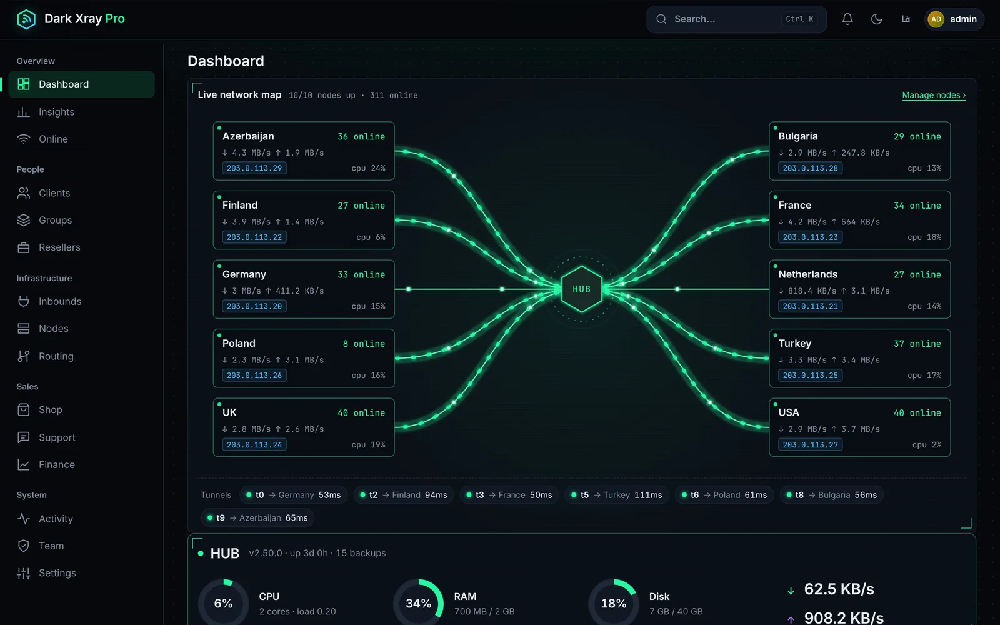
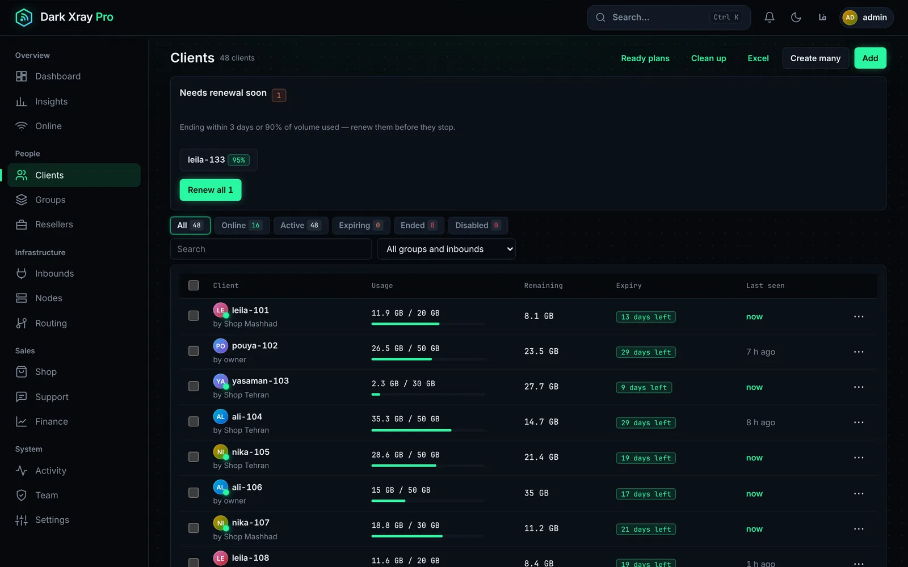
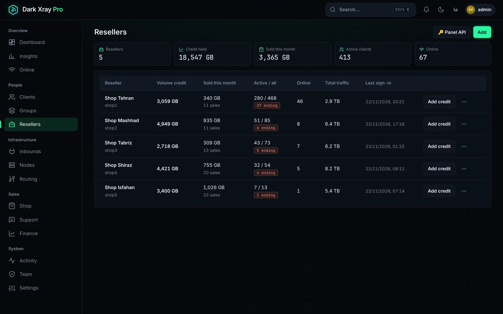
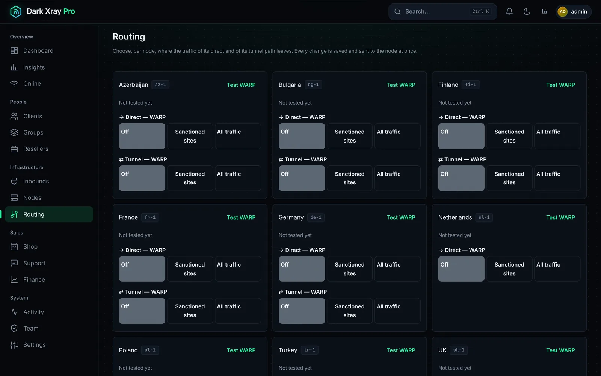
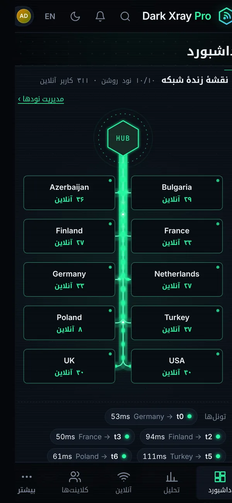
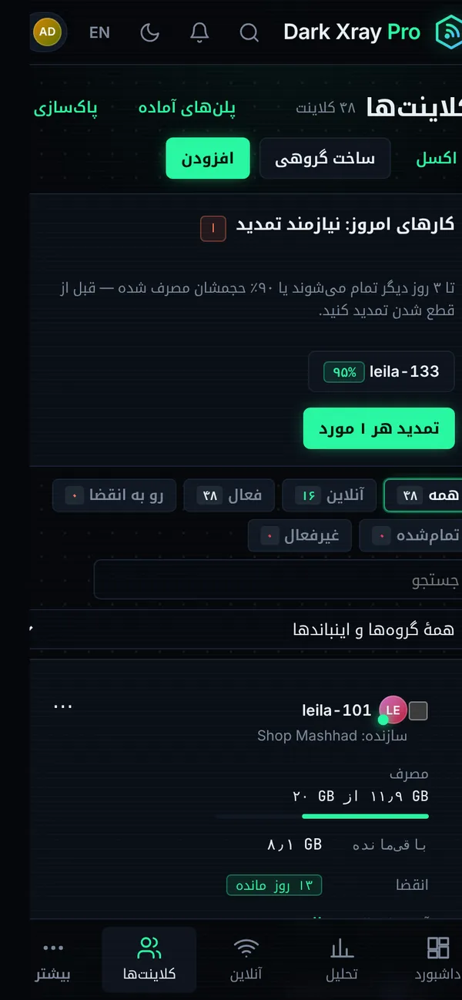

<div align="center">

# Dark Xray Pro

**A multi-server Xray panel with resellers, a Telegram store and a PasarGuard-compatible API.**

One HUB manages any number of nodes. Customers, resellers and payments live in one place;
nodes only run Xray and keep serving even while the panel is down.

[فارسی](README.fa.md) · [Install](#install) · [Features](#features) · [dxp manager](#the-dxp-manager) · [Releases](https://github.com/darktunnelmika/dark-xray-pro/releases)



</div>

## Install

On a fresh Ubuntu 22.04+ or Debian 12+ server (amd64 or arm64), as root:

```bash
bash <(curl -fsSL https://raw.githubusercontent.com/darktunnelmika/dark-xray-pro/main/scripts/install.sh)
```

The installer asks for a domain (optional), the panel port, a certificate (free Let's Encrypt, your own
files, or none), the admin login and a secret panel path, then prints the panel address. It takes about
two minutes. Afterwards, type `dxp` for the management menu.

To add a node, open **Nodes → Add node** in the panel and run the one-line command it shows on the node
server. Nodes need nothing else.

<details>
<summary>Unattended install</summary>

Every question has a variable; `DXP_YES=1` takes the default for anything not given.

```bash
DXP_YES=1 DXP_DOMAIN=panel.example.com DXP_CERT=1 DXP_ADMIN=admin DXP_PASS='a-long-password' \
  bash <(curl -fsSL https://raw.githubusercontent.com/darktunnelmika/dark-xray-pro/main/scripts/install.sh)
```

| Variable | Meaning | Default |
| --- | --- | --- |
| `DXP_DOMAIN` | panel domain (must point at the server) | the server IP |
| `DXP_PORT` | panel port | `2087` |
| `DXP_CERT` | `1` Let's Encrypt, `2` own files, `3` none | `1` with a domain |
| `DXP_CERT_FILE`, `DXP_KEY_FILE` | certificate files for `DXP_CERT=2` | |
| `DXP_ADMIN`, `DXP_PASS` | admin login | `admin`, random |
| `DXP_PATH` | secret panel path (empty = none) | random |
| `DXP_NODE_PORT` | port nodes connect to | `28443` |
| `DXP_NAME` | panel name | `Dark Xray Pro` |

</details>

## Features

**Servers**
- One HUB, many nodes; a node is added with one command and kept in sync automatically
- Live network map, per-node CPU, RAM, traffic, online users and tunnel health
- Nodes keep serving with their last configuration while the HUB is unreachable; usage is queued and delivered later
- Xray version manager, node agent self-update, HUB update from the latest release
- Move the HUB to a new server with a full backup; nodes follow a domain without being touched

**Inbounds and routing**
- VLESS, VMess, Trojan and Shadowsocks over TCP, WebSocket and gRPC with REALITY or TLS
- Direct and tunnel paths per node in one subscription
- Routing per node: WARP for all traffic or only sanctioned and AI sites, with a test that shows the exit country
- Blocking for BitTorrent, ads and chosen sites; free certificates (Let's Encrypt, Cloudflare DNS)

**Customers**
- Volume, time or unlimited plans; terms that start at the first connection; IP and device limits
- Bulk create and renew, groups, next plan, scheduled usage resets
- A branded subscription page with QR codes and links for every app

**Resellers**
- Resellers and sub-sellers with GB or unlimited-plan credit, limits per reseller and refunds
- Each reseller gets its own panel login, Telegram store bot, brand and card-to-card payments
- A partner API so another bot or website can sell reseller panels on its own

**Telegram store**
- Shop, free trial, wallet, card-to-card receipts and Telegram Stars
- Invite links with a discount for the friend and a volume gift for the inviter
- Mini App, expiry and volume reminders, a menu you arrange and colour from the panel

**Integrations and security**
- PasarGuard-compatible API: connect Mirza or any PasarGuard sales bot, for the owner or per reseller
- Owner API keys, webhooks, change log of every action
- Secret panel path, two-step sign-in, sign-in lockout, trusted IPs
- Automatic backups and encrypted full backups



| Resellers | Routing |
| --- | --- |
|  |  |

<p align="center">


</p>

## The dxp manager

`dxp` with no arguments opens a menu; every item is also a command:

| Command | What it does |
| --- | --- |
| `dxp status` | version, state, panel address, nodes online, certificate expiry |
| `dxp start` / `stop` / `restart` | control the HUB service |
| `dxp logs` | follow the HUB log |
| `dxp update` | update to the latest release (keeps a database copy, rolls back if it fails to start) |
| `dxp port 8443` | change the panel port |
| `dxp domain panel.example.com` | set the panel domain and get a certificate |
| `dxp cert` | Let's Encrypt, your own certificate files, or renew now |
| `dxp path` | change or turn off (`dxp path -`) the secret panel path |
| `dxp admin` | reset the admin login (also clears two-step sign-in) |
| `dxp backup` | encrypted full backup: database, keys and settings |
| `dxp restore file.dkb` | restore a backup, also on a new server |
| `dxp node` | how to add a node |
| `dxp firewall` | open the needed ports with ufw |
| `dxp bbr` | turn on TCP BBR |
| `dxp uninstall` | remove the HUB (data is kept unless you ask) |

## Moving to a new server

1. In the panel, give nodes a domain for the HUB (**Settings → Backup and migration → HUB address for nodes**); nodes switch to it.
2. `dxp backup` on the old server, copy the file, `dxp restore file.dkb` on the new one.
3. Point the domains at the new server. Nodes reconnect by themselves; customers' links do not change.

## Requirements

- HUB: 1 CPU, 1 GB RAM for a few hundred customers; Ubuntu 22.04+ or Debian 12+, systemd
- Node: any small Ubuntu/Debian server; amd64 or arm64
- Ports: the panel port (default 2087), 28443 for nodes, 80 while a certificate is issued

## License

Copyright © 2026 Dark Xray Pro. All rights reserved — see [LICENSE](LICENSE).
You may install and run the official releases. Copying, modifying, redistributing or reselling the
code, or a renamed copy of it, needs written permission. Bundled third-party components keep their own
licenses ([third_party](third_party)); Xray-core is downloaded from its official releases.
